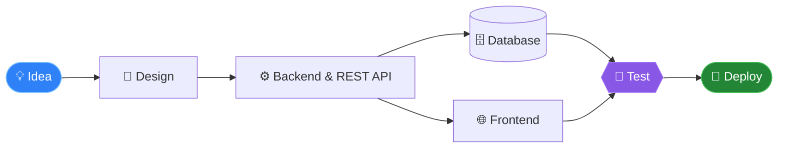

 

  

## 👨‍💻 About Me

I'm a **Software Developer** passionate about building efficient, scalable, and user-friendly applications. I enjoy working with modern technologies, developing REST APIs, integrating backend services, and creating dynamic web applications.

I'm always eager to learn new technologies, solve challenging problems, and turn ideas into practical solutions.

| | What I Do | Focus |
|:-:|-----------|-------|
| 🌐 | **Full-Stack Web Development** | Responsive, dynamic web applications |
| 🔌 | **API Development & Integration** | Secure, well-structured REST APIs |
| ⚙️ | **Backend Development** | Scalable services and business logic |
| 🗄️ | **Database Management** | Relational and NoSQL data design |
| 🧩 | **Problem Solving** | Clean, maintainable solutions |

## 🔄 How I Build

## 🛠️ Tech Stack

**Languages**

**Frameworks & Libraries**

**Databases**

**Tools & Platforms**

 

## 🚀 Featured Projects

| Project | Type | Tech Used |
|---------|------|-----------|
| 📦 [**Courier App**](https://github.com/ak-tiwari-09/courier) | Courier management app |    |
| 🖥️ [**FMCS Web UI**](https://github.com/ak-tiwari-09/FMCS_New_Ui) | Frontend UI |   |
| 🔌 [**FMCS REST API**](https://github.com/ak-tiwari-09/FMCS_Api) | REST API / Backend |   |
| 🧩 [**CMS Portal**](https://github.com/ak-tiwari-09/CMS_Update) | Content management system |    |

## 📊 GitHub Stats

 

<!--
  DAILY AUTO-UPDATED METRICS (optional)
  Un-comment this block ONLY after the "Metrics" GitHub Action has run once
  and github-metrics.svg exists in this repository.

-->

## 💬 Dev Quote

## 🤝 Let's Connect

 

⭐ *If you like my work, consider giving a repo a star!* ⭐

